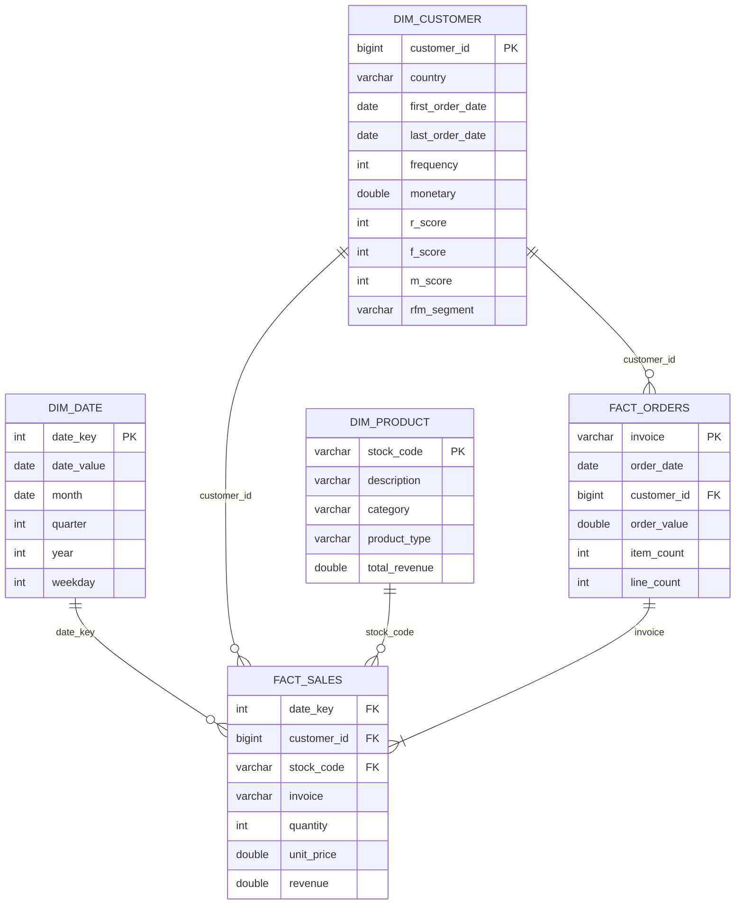
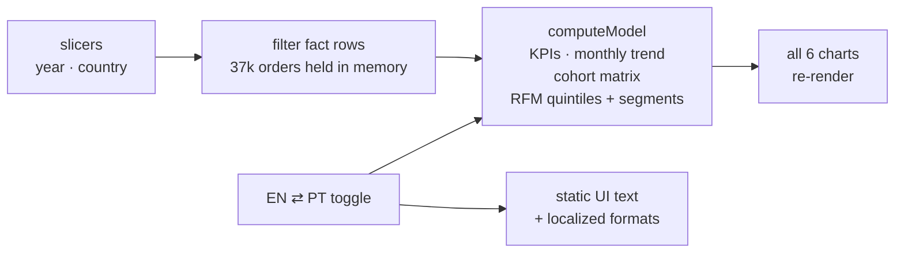

# Retail Marketing Analytics

[](https://github.com/leandro-v-silva/website/actions/workflows/ci.yml)

End-to-end analytics project on **1M+ retail transactions** (Online Retail II,
UCI ML Repository — CC BY 4.0, also mirrored on Kaggle): a DuckDB-powered ETL
that models the data as a **star schema**, and a **D3.js dashboard** with
marketing indicators — RFM segmentation, cohort retention, new-vs-returning
revenue, AOV and basket size.

The dashboard emulates BI-tool behavior: **Power BI-style slicers** (year,
country) re-filter the fact rows and recalculate every KPI and chart in the
browser, and the whole UI is **bilingual (English / Português)** with
locale-aware number formats.

## How the data flows

```mermaid
flowchart LR
    A["Online Retail II.xlsx<br/>1.07M rows · UCI / Kaggle<br/>CC BY 4.0"] --> B["etl/extract.py<br/>stream xlsx to csv<br/>bulk COPY"]
    subgraph DB["DuckDB · analytics.duckdb"]
        direction TB
        B --> C["stg_raw<br/>1:1 with source sheets"]
        C --> D["stg_clean<br/>dedupe · drop cancellations<br/>· drop missing customer_id<br/>· drop non-positive lines"]
        D --> E["star schema dimensions<br/>dim_date · dim_customer<br/>dim_product"]
        E --> F["fact_sales · fact_orders"]
        F --> G["mart_* tables<br/>KPIs · monthly · cohorts<br/>RFM · products · countries<br/>+ mart_orders export"]
    end
    G --> H["etl/export.py<br/>order-grain fact rows"]
    H --> I["report/data.js<br/>embedded JSON · ~37k orders"]
    I --> J["D3 v7 dashboard<br/>slicers recompute measures<br/>EN ⇄ PT"]
```



The transformation logic lives in plain, version-controlled SQL (`sql/`);
Python is only the orchestrator. Every run rebuilds all layers from
`stg_raw`, so the pipeline is idempotent.

## Quickstart

```bash
make all        # venv + deps, download dataset, run ETL, export dashboard data
make report     # serve report/ at http://localhost:8000
```

or step by step:

```bash
make setup      # python3 -m venv .venv && pip install -r requirements.txt
make data       # download the xlsx from UCI and load raw rows into DuckDB
make etl        # build the cleaned layer, star schema and marts
make export     # dump the order-grain fact rows to report/data.js
```

No `make`? Run the Python scripts directly (`.venv/bin/python etl/extract.py`, …).
The dataset download is ~45 MB and the xlsx-to-CSV conversion takes a few
minutes on the first run (then cached in `data/raw/`, git-ignored).

The dashboard is fully static: `report/index.html` also works when opened
straight from disk, because the data is embedded as a JS global (`data.js`)
and D3 is vendored under `report/vendor/`.

## What the dashboard shows

| Section | Question it answers |
| --- | --- |
| KPI cards | How much revenue, how many orders/customers, repeat rate, basket size |
| Monthly revenue | Is the business growing? Seasonality? |
| New vs returning | Does growth come from acquisition or retention? |
| Cohort retention | How sticky are newly acquired customers? |
| RFM segments | Where is revenue concentrated? Who is about to churn? |
| Top products | What drives the catalogue? |
| Revenue by country | How dependent is the business on its home market? |

**Slicers** (the Power BI part): pick a **year** (chips) and/or a **country**
(dropdown, 41 markets) and every section recalculates — KPIs, trend, cohorts
and the RFM quantiles themselves, because measures are computed from the
filtered fact rows, not pre-baked aggregates. Combinations with no data show
an explicit empty state. The Top-products chart is the one static section
(product-level rows would be too heavy to ship to the browser).

**Language**: the EN/PT toggle in the header translates every label, tooltip
and legend, and switches number formats (`72.4%` ↔ `72,4%`). The choice is
remembered between visits.

## Star schema



`fact_sales` is one row per order line and joins to every dimension;
`fact_orders` is a second fact table at invoice grain used for AOV and
basket-size metrics. `dim_customer` carries RFM quantile scores (1–5) on
recency, frequency and monetary value, labelled with the standard RFM playbook
(Champions, Loyal, Potential loyalists, New, At risk, Hibernating, …).

Cleaning rules (all in `sql/01_clean.sql`, documented there):

- cancellations (invoice prefix `C`) and bad-debt adjustments (`A`) are dropped;
- lines without a `customer_id` are dropped (marketing KPIs need attribution);
- non-positive quantities/prices are dropped;
- exact duplicates are removed.

## Why the browser computes the measures



Shipping pre-aggregated marts would make filtering cosmetic (charts could only
show/hide). Computing the measures from the filtered fact rows is what makes
the slicers honest — the same filter→measure semantics as Power BI, with no
BI server.

## Repo layout

```
├── Makefile              # all / setup / data / etl / export / report / clean
├── requirements.txt      # pinned (duckdb==1.5.6) for reproducibility
├── package.json          # dev-only: jsdom test harness (report is dependency-free)
├── etl/
│   ├── extract.py        # download + raw load into DuckDB staging
│   ├── transform.py      # runs sql/01–04 in order (idempotent rebuild)
│   └── export.py         # order-grain fact rows + top products → data.js
├── sql/
│   ├── 01_clean.sql      # staging → cleaned layer
│   ├── 02_dimensions.sql # dim_date, dim_customer (RFM), dim_product
│   ├── 03_facts.sql      # fact_sales, fact_orders
│   └── 04_marts.sql      # mart_* + mart_orders (dashboard export)
├── report/               # static D3 dashboard (works from file://)
│   ├── index.html
│   ├── css/style.css
│   ├── js/dashboard.js   # i18n + slicers + measure engine
│   ├── vendor/d3.min.js
│   └── data.js           # generated by etl/export.py — committed on purpose
├── tests/                # jsdom headless tests (npm ci && npm test)
├── scripts/verify-data.js# CI: is committed data.js reproducible?
├── .github/workflows/    # CI: report validation + full ETL rebuild
└── data/raw/             # downloaded xlsx/csv (git-ignored)
```

## CI/CD

Every push and pull request runs `.github/workflows/ci.yml` with two jobs:

1. **Validate dashboard** (fast): JS syntax checks, then a jsdom
   headless-browser suite that loads the real page, clicks the slicers and
   asserts the recomputed KPIs against DuckDB-verified ground truth
   (year=2010 → £8.37M / 18,325 orders; France → £349k; empty selection →
   empty state; PT → localized formats).
2. **Rebuild ETL** (~15 min): downloads the dataset, reruns the full pipeline
   in CI, and fails if the regenerated `data.js` is not semantically
   identical to the committed one — i.e. the published dashboard is provably
   reproducible from the SQL.

## Notes for reviewers

- **Reproducibility**: `make clean && make all` rebuilds everything from the
  downloaded file; CI enforces the same on every push.
- **Why DuckDB**: single-file OLAP engine, runs the whole pipeline locally
  with zero services, and the xlsx → SQL → JSON path stays in one tool.
- **Why embedded data.js**: `fetch()` of local JSON is blocked on `file://`;
  a JS global keeps the report double-clickable for anyone cloning the repo.
- **Why bilingual**: the toggle demonstrates locale-aware formatting and a
  maintainable i18n dictionary in `js/dashboard.js`.
- The dataset covers Dec 2009 – Dec 2011. The final month (Dec 2011, 9 days)
  is excluded from the monthly trend to avoid a misleading partial-month drop;
  retention for recent cohorts is based on fewer months of observation by
  construction.

## License / attribution

Dataset: *Online Retail II*, Daqing Chen, UCI Machine Learning Repository,
CC BY 4.0, [DOI 10.24432/C5CG4D](https://doi.org/10.24432/C5CG4D); also mirrored
on Kaggle as "Online Retail II". Code in this repo: MIT.
